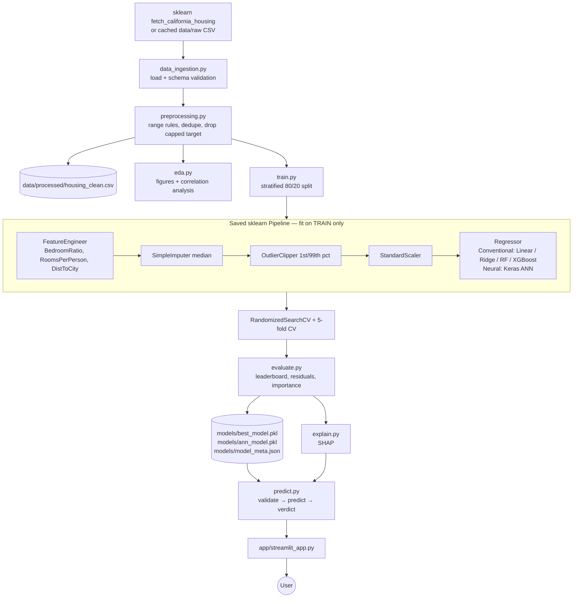

# Architecture

## Data flow



## Module responsibilities

| Module | Responsibility | Key functions |
|---|---|---|
| `config.py` | All paths, column names, validation ranges, hyperparameters | — |
| `data_ingestion.py` | Load data (cache → download), schema checks | `load_raw_data`, `validate_schema` |
| `preprocessing.py` | Row-level cleaning rules + data-quality report | `clean_data`, `data_quality_report` |
| `eda.py` | Plots and numbers that justify design decisions | `run_eda` |
| `features.py` | Custom transformers + the shared preprocessing pipeline | `FeatureEngineer`, `OutlierClipper`, `build_preprocessor` |
| `ann.py` | Keras neural network wrapped as a scikit-learn regressor (fit/predict/pickle) | `KerasANNRegressor` |
| `train.py` | Split, model candidates (4 conventional + ANN), tuning, K-fold CV | `split_data`, `train_all` |
| `evaluate.py` | Metrics, leaderboard, best-model selection, diagnostic plots | `build_leaderboard`, `select_best` |
| `explain.py` | SHAP global summary + per-prediction breakdown | `make_explainer`, `explain_prediction` |
| `predict.py` | Inference API used by the app (no UI code) | `validate_input`, `predict_value`, `fair_price_verdict` |
| `run_pipeline.py` | Orchestrates phases 1 → 8 | `main` |
| `app/streamlit_app.py` | UI only | — |

## Neural network design
```
Input (10 engineered, scaled features)
  → Dense(units, ReLU|ELU, He|Glorot init, L2) → Dropout     ┐ repeated for each hidden layer;
  → Dense(units, ...) → Dropout                               ┘ sizes tuned: 64-32 … 256-128-64
  → Dense(1, linear)                                           regression output
Loss: MSE · Optimizer: Adam or SGD (momentum 0.9, Nesterov) · Mini-batch 64/128/256
Early stopping on a 10% validation split (patience 10, best weights restored)
```
The StandardScaler in the shared pipeline matters most for the ANN: gradient descent converges
poorly when inputs are on very different scales (population in thousands vs. ratios below 1).

## Design principles
1. **No leakage** — anything that learns statistics (imputer medians, clip bounds, scaler) is inside
   the Pipeline and fitted on the training split only.
2. **One Pipeline from training to serving** — the `.pkl` contains preprocessing + model, so the app
   cannot transform inputs differently from training.
3. **UI holds no ML logic** — every rule the app uses is in `predict.py` and covered by tests.
4. **Config over magic numbers** — every threshold is in `config.py` with a comment explaining it.
